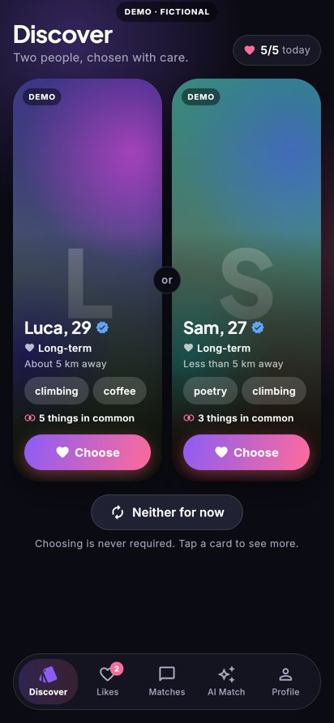
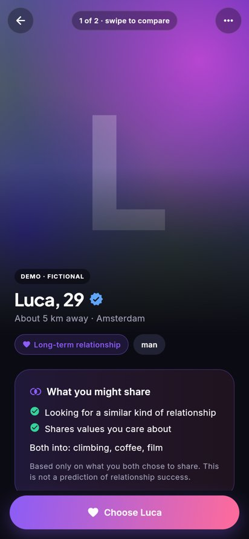
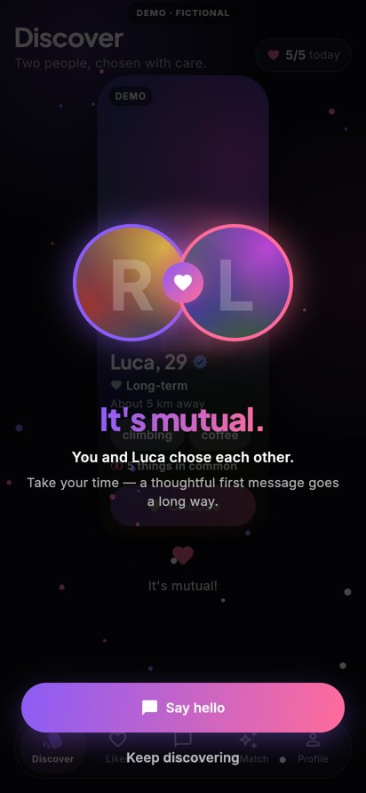
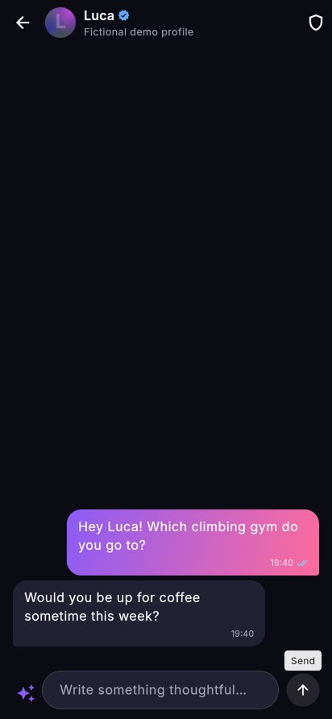
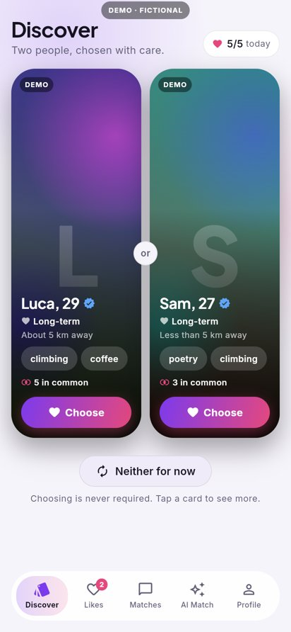

# FairMatch

FairMatch is a dating app for Android, with a Flutter client and a FastAPI/PostgreSQL backend. It replaces endless swiping with a **Two-Choice Arena**: you see two people at a time and can choose one, choose neither, or open either profile before deciding. A match exists only when both people have chosen each other.

> **Status: working prototype, not production-ready.** See [What is implemented, mocked or pending](#what-is-implemented-mocked-or-pending) before launching anything.

| Arena | Profile | Mutual match | Chat | Light mode |
|---|---|---|---|---|
|  |  |  |  |  |

More screenshots are in [`docs/screenshots`](docs/screenshots). They were rendered from the real Flutter code, built for web and driven by Playwright. People shown in demo mode are fictional and carry a "DEMO" label.

---

## Repository layout

```
fairmatch/
├── backend/                  FastAPI service
│   ├── app/
│   │   ├── api/              HTTP + WebSocket routers (auth, profile, discover, matches, misc, admin)
│   │   ├── services/         Domain logic (matching, queue, messaging, billing, AI, safety, privacy…)
│   │   ├── models.py         SQLAlchemy models (PostgreSQL is the source of truth)
│   │   ├── seed_demo.py      Fictional demo data (is_demo = true, isolated from real users)
│   │   └── main.py
│   ├── migrations/           Alembic migrations
│   ├── tests/                pytest suite (runs against real PostgreSQL)
│   └── Dockerfile
├── mobile/                   Flutter app (Riverpod + GoRouter)
│   ├── lib/
│   │   ├── core/theme.dart   Design system: colour/spacing/radius/motion tokens, dark + light themes
│   │   ├── data/             Models, repository contract, HTTP/WebSocket client, offline demo repository
│   │   ├── state/            Riverpod providers, Google Play Billing bridge
│   │   ├── features/         discover, likes, matches (chat), ai, profile, onboarding, shell
│   │   └── widgets/          Shared UI (portraits, glass, buttons, skeletons, states)
│   └── test/                 Widget + repository tests
├── docker-compose.yml        Local stack: PostgreSQL, Redis, API
└── docs/screenshots/
```

The CI workflow is `.github/workflows/fairmatch.yml`. It runs the backend tests against PostgreSQL, runs `flutter analyze` and `flutter test`, builds a debug APK and uploads it as an artifact. When signing secrets are set, it also builds a signed release AAB.

---

## Quick start

### 1. Backend

With Docker:

```bash
cd fairmatch
docker compose up --build            # API on http://localhost:8000, docs at /docs
docker compose exec api python -m app.seed_demo   # optional fictional demo data
```

Without Docker (Python 3.12+, PostgreSQL 16, optional Redis):

```bash
cd fairmatch/backend
python -m venv .venv && . .venv/bin/activate
pip install -r requirements-dev.txt
cp .env.example .env                 # then edit secrets
createdb fairmatch
alembic upgrade head
python -m app.seed_demo              # optional
uvicorn app.main:app --reload
```

The demo login after seeding is `demo@demo.fairmatch.app` / `fairmatch-demo-2026`. Demo accounts can only ever see other demo accounts.

### 2. Mobile app

```bash
cd fairmatch/mobile
flutter pub get
flutter run --dart-define=FM_API_URL=http://10.0.2.2:8000   # Android emulator → host backend
```

- If you don't pass `FM_API_URL`, the app uses `http://10.0.2.2:8000`. Debug builds allow cleartext HTTP so they can reach a local server. Release builds block it, so they need HTTPS.
- You can try the app without a server: tap **"Explore the demo with fictional profiles"** on the welcome screen. Demo mode runs fully on-device and follows the same rules as the server (daily selections, pending capacity, honest request states, mutual-only matches). Purchases in demo mode are simulated and clearly labelled.

### 3. Android builds

- **Debug APK:** `flutter build apk --debug`. You can also download the `fairmatch-debug-apk` artifact from the *FairMatch CI* workflow run on GitHub Actions.
- **Release AAB:** create an upload keystore and add `android/key.properties`. Don't commit it.

  ```properties
  storePassword=…
  keyPassword=…
  keyAlias=upload
  storeFile=upload-keystore.jks     # relative to android/app
  ```

  Then run `flutter build appbundle --release --dart-define=FM_API_URL=https://api.your-domain`.

  In CI, set the `ANDROID_KEYSTORE_BASE64` and `ANDROID_KEY_PROPERTIES` secrets, plus an `FM_API_URL` repository variable.

  Without `key.properties`, release builds are signed with the debug key. Never upload those to Play.

### 4. Tests

```bash
cd fairmatch/backend && pytest -q          # needs PostgreSQL; uses database fairmatch_test
cd fairmatch/mobile && flutter analyze && flutter test
```

---

## Backend configuration

All settings are environment variables with the `FM_` prefix (see `backend/.env.example`):

| Variable | Purpose |
|---|---|
| `FM_ENV` | `development` / `test` / `production`. Production refuses to start with default secrets, `*` CORS or dev billing. |
| `FM_DATABASE_URL` | PostgreSQL URL (`postgresql+psycopg://…`) |
| `FM_REDIS_URL` | Optional. Shared rate limiting and multi-instance WebSocket fan-out. Without it, the API falls back to in-process. |
| `FM_JWT_SECRET`, `FM_MEDIA_URL_SECRET` | Long random secrets |
| `FM_PUBLIC_BASE_URL` | Base for signed media URLs |
| `FM_STORAGE_BACKEND` | `local` (dev) or `s3` (S3-compatible; install `boto3`, set `FM_S3_BUCKET` and `FM_S3_ENDPOINT_URL`) |
| `FM_AI_PROVIDER` | `mock` (rule-based, offline) or `anthropic` (needs `ANTHROPIC_API_KEY`). The model defaults to `claude-opus-5-5` (`FM_ANTHROPIC_MODEL`). |
| `FM_BILLING_MODE` | `dev` (accepts `dev-*` tokens; refused in production) or `google_play` (needs `FM_GOOGLE_SERVICE_ACCOUNT_FILE` and `FM_GOOGLE_PLAY_PACKAGE_NAME`) |
| `FM_RTDN_SHARED_SECRET` | Token for the Google Play Real-time Developer Notifications push endpoint |
| `FM_PUSH_PROVIDER` | `log` (dev) or `fcm` (needs `FM_FCM_PROJECT_ID` and a service-account file) |

**Product tunables are server-configurable at runtime.** You change them through `PUT /admin/config/{section}`, and every change is written to the audit log. This covers daily selections per tier, pending capacity (2), the pending TTL (48 h), the waitlist TTL, the matching weights, fairness λ, the boost cap (10%), prices, entitlements and safety thresholds. Defaults are in `backend/app/services/app_config.py`.

---

## How matching works

1. **Eligibility (reciprocal).** Both people must fit each other's age range, gender preferences, distance and dealbreakers. Blocked accounts, accounts that aren't active and accounts under review are excluded. Relationship intents that hard-conflict are excluded too (long-term vs. casual). Demo accounts never mix with real ones. A SQL prefilter narrows the pool and an exact Python check (`services/eligibility.py`) confirms each candidate.
2. **Compatibility.** A configurable weighted score (`services/compatibility.py`): relationship goals 30%, values and lifestyle 25%, mutual preferences 20%, communication 15%, shared interests 10%.
   - Missing answers are left out of the score rather than guessed. That lowers a *confidence* value.
   - When confidence is low, clients get an honest "not enough information" explanation.
   - **Clients never receive the numeric score.** They get qualitative highlights only.
   - The weights are experimental, not validated science.
3. **Fair exposure** (`services/fairness.py`). The ranking is `(1-λ)·compatibility + λ·exposure_bonus`. The exposure bonus favours people with fewer impressions over the last 7 days.
   - The number of likes someone receives is **never** used, which avoids popularity feedback loops.
   - Candidates whose request inbox is already full are deprioritised.
   - `/admin/fairness` reports the Gini coefficient, the top-decile share and the share of eligible users with zero exposure.
4. **Two-choice generation** (`services/pairing.py`). The first card is sampled from the top-k candidates. The second card maximises rank minus a similarity penalty, so the two people differ.
   - Anyone who already chose the viewer is always given a slot, so free users can answer them.
   - Boosted profiles get a small bonus. Boosted placements are capped at 10% of each viewer's slots, labelled "Promoted", and never bypass eligibility.
   - People the viewer passed on are not shown again for 30 days.
   - Small pools return one card or an honest empty state. The app never shows fabricated people.
5. **Interest queue** (`services/interests.py`). The state machine:

   ```
   PROPOSED → SELECTED → PENDING ──→ MATCHED | REJECTED | EXPIRED | CANCELED
                       ↘ WAITLISTED → PENDING (promoted FIFO) | EXPIRED | CANCELED | REJECTED
                       ↘ MATCHED (the other person had already chosen you)
   ```

   - **Concurrency.** Every mutation runs in one transaction that locks both users' rows (`SELECT … FOR UPDATE`, in id order). That serialises quota use, pending-capacity checks and mutual detection. Partial unique indexes are a second guard: one active interest per ordered pair, and one match per pair.
   - **Idempotency.** Selections need an `Idempotency-Key` header. Messages need a `client_message_id`.
   - **Honest delivery.** Recipients only ever see PENDING requests. Senders see "Waiting in line" for WAITLISTED requests, never "delivered".
   - **Free answers.** Choosing back someone who already chose you is always free.
   - **Expiry.** A background job expires overdue requests and promotes waitlisted ones.

---

## API overview

The interactive OpenAPI docs are at `/docs` (disabled in production).

- **Auth:** `POST /auth/register` (18+ enforced; nothing is stored for minors), `/auth/login`, `/auth/refresh` (rotation with reuse detection), `/auth/logout`
- **Me:** `GET /me`, `PATCH /me/profile`, `POST/DELETE /me/photos` (re-encoded server-side, which strips EXIF/GPS), `GET /me/export`, `DELETE /me`, `POST /me/consents`, `POST /me/devices`, `GET /me/analytics` (Plus)
- **Discover:** `GET /discover/pair`, `POST /discover/select`, `POST /discover/pass/{pair_id}`, `GET /users/{id}` (only visible when there is an existing relationship context)
- **Likes:** `GET /likes`, `POST /likes/{id}/respond` (Plus), `POST /likes/{id}/cancel`
- **Matches:** `GET /matches`, `GET/POST /matches/{id}/messages` (cursor pagination plus `after_id` for offline recovery), `POST /matches/{id}/read`, `POST /matches/{id}/unmatch`
- **Realtime:** `WS /ws`. The first frame is `{"type":"auth","token":…}`, so tokens never appear in URLs. Events: `message`, `typing`, `read`, `match`, `interest_received`, `match_closed`.
- **AI:** `POST /ai/insights/{user_id}`, `POST /ai/rephrase`, `GET /ai/reflection` (Premium AI, with consent)
- **Billing:** `GET /billing/products`, `POST /billing/verify`, `GET /billing/subscriptions`, `POST /billing/rtdn`
- **Safety:** `POST /safety/block`, `DELETE /safety/block/{id}`, `POST /safety/report`
- **Admin** (moderator/admin roles): reports queue, moderation actions, verification, age assurance, config, fairness metrics, audit log

---

## Privacy, safety and AI guardrails

- **Adults only.** Date of birth is checked on the server and on the device. Under-18 attempts store nothing. An "underage" report hides the account immediately pending review.
- **Approximate location.** Coordinates are snapped to a ~2 km grid before storage. Other people only see a bucketed distance such as "About 10 km away".
- **Photos.** Server-side re-encoding removes EXIF/GPS. Media is served through short-lived signed URLs, issued only inside authorised responses.
- **Reporting and moderation.** Three independent reporters automatically hide an account for review. Spam heuristics cover links in a first message and copy-paste fan-out. A suspicion score feeds the same review queue. Every moderator and admin action is audit-logged.
- **Read receipts are reciprocal.** You only see someone's read receipts if you share yours.
- **GDPR.** Users can export their data as JSON. Account deletion hides the account and revokes sessions immediately, then purges personal data after a configurable grace period (7 days). Consents are recorded with versions.
- **AI.** Calls go through a provider abstraction (`services/ai.py`) and require both a Premium AI subscription and explicit consent.
  - Only whitelisted *text* profile fields are sent. Photos, messages, location, email and date of birth are never sent.
  - People can opt out of having their profile analysed by other users' AI.
  - Profile text is treated as untrusted data in the prompt.
  - The AI produces no numeric scores, does no attractiveness or face analysis, and does not infer sensitive traits.
  - If the provider fails or refuses, the feature falls back to rule-based suggestions.
  - With `FM_AI_PROVIDER=anthropic`, requests use `claude-opus-5-5` with server-side refusal fallbacks enabled (`fallbacks: "default"`).
- **Messaging is not end-to-end encrypted.** It uses TLS in transit plus server-side authorisation, and the app says so explicitly.

---

## Test results (this build)

- **Backend:** 63 pytest tests pass against PostgreSQL 16. They cover:
  - eligibility, compatibility, fairness (including an exposure-inequality simulation) and boost caps
  - the state machine, pending capacity and waitlist, expiry and promotion, quotas and idempotency
  - **real concurrent races using threads:** 12 simultaneous senders to one recipient, simultaneous mutual selection, a duplicate idempotency key, quota exhaustion, and accept vs. cancel
  - auth (minors, refresh rotation and reuse, rate limiting) and API authorisation (profiles, conversations, admin roles)
  - the entitlement matrix, server-side purchase verification, blocking, reporting and moderation, export and deletion, WebSocket auth and events, and migrations (upgrade → check → downgrade → upgrade)
- **Mobile:** `flutter analyze` reports no issues, and 17 Flutter tests pass. They cover the arena, honest request status, loading, empty and offline states, three screen sizes (320×568, 360×740, 1024×1366), Likes, Chat, under-18 blocking, Welcome, the demo's rules, and the HTTP client (error mapping, idempotency header, token refresh, offline).
- **End-to-end:** a Playwright run against the web build and a live backend: register → 11-step onboarding with photo upload → real pair → selection → PENDING status shown on the Likes screen.
- **CI:** the GitHub Actions *FairMatch CI* workflow passes and produces the debug APK artifact.

---

## What is implemented, mocked or pending

| Area | Status |
|---|---|
| Two-choice discovery, reciprocal eligibility, compatibility, fair exposure, boost cap | ✅ Implemented and tested |
| Interest queue (capacity, waitlist, expiry, idempotency, race-safety), mutual matching | ✅ Implemented and tested |
| Messaging (REST + WebSocket, delivery/read status, typing, pagination, offline catch-up, idempotent resend) | ✅ Implemented. Redis fan-out is wired up but only exercised with a single instance. |
| Auth (scrypt passwords, JWT access + rotating refresh, reuse detection) | ✅ Implemented |
| Safety: block, report, unmatch, rate limits, spam heuristics, moderation and audit log | ✅ Implemented (there is no moderation **web UI**, only API) |
| GDPR export, deletion and purge, consents | ✅ Implemented. Export is returned inline, not as an async e-mailed file. |
| Google Play Billing | ⚠️ Client purchase flow and server verification (Play Developer API) are implemented but **untested against real Play credentials**. Dev mode uses `dev-*` tokens. RTDN uses a shared-secret token, not Pub/Sub OIDC verification. |
| AI assistant | ⚠️ Rule-based provider works offline. The Anthropic provider is implemented but was not exercised with a live key in this environment. |
| Push notifications | ⚠️ The backend FCM HTTP v1 sender is implemented but untested. **The client does not yet register an FCM token** (needs `firebase_messaging` plus `google-services.json`). |
| Age assurance | ⚠️ Self-declared date of birth, plus moderator-set assurance levels. A third-party age-estimation or ID provider is **pending**. |
| Photo verification | ⚠️ Status field plus a moderator API. Selfie and liveness capture flow **pending**. |
| Photo moderation | ⚠️ A hook exists (`moderation_status`), but no automated classifier. Photos are auto-approved. |
| S3 storage | ⚠️ Implemented (`boto3`), untested. Local storage is used in development. |
| Release AAB | ⚠️ Built by CI only once signing secrets are configured. |
| iOS | ❌ Not targeted (Android-first) |

The Android SDK could not be downloaded in the development container (`dl.google.com` is blocked by its egress policy), so APKs are built in GitHub Actions instead.

---

## Recommended next steps

1. Wire up Firebase: `firebase_messaging` on the client, plus token registration through `/me/devices`.
2. Test Google Play Billing end-to-end in a closed testing track. Switch RTDN to Pub/Sub push with OIDC verification.
3. Integrate an age-assurance provider and a selfie-liveness verification flow. Add automated photo moderation.
4. Build a moderation and operations web console on top of the `/admin` API.
5. Load-test pair generation. Precompute candidate pools and exposure counters (Redis or materialised views) for large cities.
6. Commission a security review and penetration test, a GDPR DPIA (dating data can reveal sexual orientation, which is special-category data), and accessibility testing with TalkBack.
7. Add observability (structured logs, metrics, tracing) and set up backups and disaster recovery for PostgreSQL and media.
8. A/B-evaluate the matching weights and fairness λ against match and conversation quality, not time-in-app.
